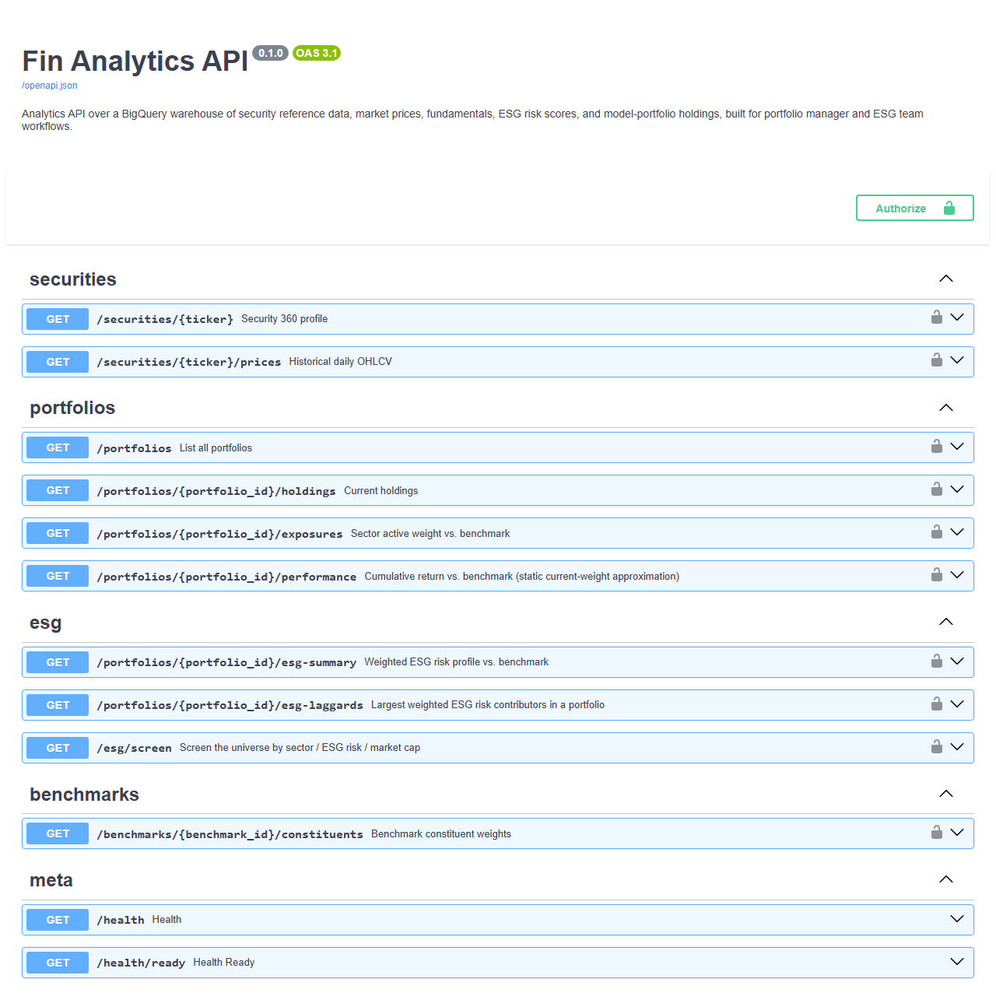
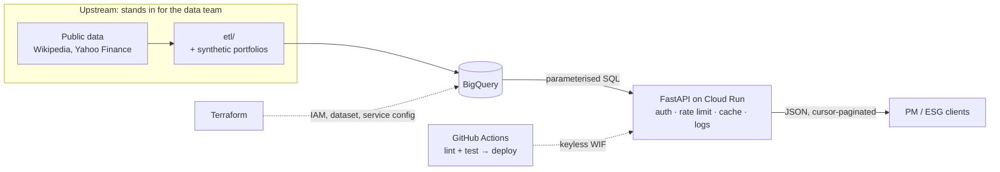

# Fin Analytics API

[](https://github.com/SaaSGun/fin-analytics-api/actions/workflows/ci.yml)


[](LICENSE)

A read-only analytics API for an investment manager's portfolio managers
and ESG team: security profiles, portfolio holdings, sector exposures,
performance vs. benchmark, and ESG risk screening. A FastAPI service on
Google Cloud Run serves it from a BigQuery warehouse.

> **Portfolio project.** This repo shows backend API design and production
> engineering on GCP: Python, FastAPI, BigQuery, Cloud Run, Terraform and
> GitHub Actions. The data mixes real public market data with synthetic
> portfolios. The premise is that a data engineering team has already loaded
> clean data into BigQuery, and this service exposes it to internal users.

Its transactional (OLTP) counterpart is
[fin-order-management-api](https://github.com/SaaSGun/fin-order-management-api):
the write side of the same domain (orders, pre-trade compliance, fills,
settlement) on PostgreSQL, with the same API conventions.

## Live demo

**https://fin-analytics-api-1089997989086.europe-west4.run.app**

- [`/health`](https://fin-analytics-api-1089997989086.europe-west4.run.app/health) — no auth.
- [`/docs`](https://fin-analytics-api-1089997989086.europe-west4.run.app/docs) — Swagger UI
  for every endpoint, its parameters, and the scope it needs.

[](https://fin-analytics-api-1089997989086.europe-west4.run.app/docs)

API keys are deliberately not published in this repo (a key in a public
repo is effectively public forever). Evaluation keys, which expire after
a week, are issued on request, together with the
[playground notebook](https://github.com/SaaSGun/fin-api-playground).
It runs guided scenarios against this API and the order-management API
from Colab. With a key:

```bash
curl -H "X-API-Key: <your-key>" \
  https://fin-analytics-api-1089997989086.europe-west4.run.app/securities/AAPL
```

## Highlights

- **Domain-driven endpoints.** The 10 endpoints follow real buy-side
  workflows, such as a PM's sector-tilt check, finding ESG laggards, and
  screening the investment universe. Each one is tagged by audience in the
  [API spec](docs/api_spec.md).
- **Consistent contract.** Every response uses the same envelope. Lists use
  cursor (keyset) pagination with stable tiebreakers, so pages never skip
  or repeat a row. The OpenAPI contract is generated from the code, and a
  snapshot is committed ([`openapi.yaml`](docs/openapi.yaml)) so changes
  show up in review diffs.
- **Security in layers.** API keys are stored only as SHA-256 hashes.
  Scopes separate reference data (`standard:read`) from portfolio
  positions (`confidential:read`). The service runs as a read-only,
  least-privilege service account, every query is parameterised, and a
  daily BigQuery query cap bounds what any caller can cost.
- **Built for load.** The API caches query results, rate-limits each client
  with a token bucket (`429` + `Retry-After`), and caps BigQuery retries
  so an overloaded request fails fast with `503` + `Retry-After` instead of
  hanging.
- **Observability.** Logs are structured JSON tied to the Cloud Trace id.
  Every response, 500s included, carries an `X-Request-ID`. Each BigQuery
  query logs its cost (bytes processed, slot time), and Terraform defines
  log-based metrics on top of these logs.
- **Load-tested in production.** Load tests against the live deployment
  found a tail-latency problem. After the fix, p99 latency dropped from 34s
  to 2.6s. The fix was then validated with 40 concurrent clients (see
  [Performance](#performance)).
- **Automated delivery.** GitHub Actions runs lint and an offline test suite
  on every PR, then deploys `main` to Cloud Run. Workload Identity
  Federation handles authentication, so no credentials are stored in
  GitHub. Terraform defines the GCP infrastructure.

## Five-minute tour

| Where | What it shows |
|---|---|
| [`app/auth.py`](app/auth.py) | Keys stored and looked up only as SHA-256 hashes; `{standard,confidential} × {read,write}` scopes, enforced per router with `require_scopes(...)` |
| [`app/bigquery_client.py`](app/bigquery_client.py) | Parameterised queries; a bounded, thread-safe result cache that hands out copies; BigQuery retries capped at 10s; one cost log line per billed query |
| [`app/main.py`](app/main.py) | Exhausted BigQuery retries and a spent daily query cap both become `503` + `Retry-After`, not a hung request or a bare `500` |
| [`app/rate_limit.py`](app/rate_limit.py) | Per-client token bucket, sized as a cost control: every cache miss is a billed query |
| [`app/pagination.py`](app/pagination.py) | Opaque keyset cursors instead of `OFFSET` |
| [`docs/load_test_results.md`](docs/load_test_results.md) | How a 30–120s request tail was traced to BigQuery's per-identity rate limit and silent client retries, and what fixed it |

## Architecture



## Endpoints

| Endpoint | What it answers | Audience | Scope |
|---|---|---|---|
| `GET /securities/{ticker}` | Security profile: reference data, fundamentals, ESG scores and last close in one call | PM, ESG | standard |
| `GET /securities/{ticker}/prices` | Daily OHLCV history | PM | standard |
| `GET /portfolios` | Model portfolios with strategy, AUM and benchmark | PM, ESG | confidential |
| `GET /portfolios/{id}/holdings` | Current holdings, largest weight first | PM | confidential |
| `GET /portfolios/{id}/exposures` | Sector active weights vs. benchmark | PM | confidential |
| `GET /portfolios/{id}/performance` | Cumulative return vs. benchmark | PM | confidential |
| `GET /portfolios/{id}/esg-summary` | AUM-weighted ESG risk vs. benchmark | ESG, PM | confidential |
| `GET /portfolios/{id}/esg-laggards` | Holdings that add the most ESG risk | ESG | confidential |
| `GET /esg/screen` | Universe screen by sector, ESG risk and market cap | ESG | standard |
| `GET /benchmarks/{id}/constituents` | Benchmark constituents and weights | PM | standard |

`/health` (liveness) and `/health/ready` (also checks BigQuery) need no key.
Every other endpoint returns the same envelope (values below are
illustrative):

```json
GET /portfolios/ESG_LEAD/exposures?limit=2

{
  "data": [
    {"gics_sector": "Information Technology", "portfolio_weight": 0.34, "benchmark_weight": 0.29, "active_weight": 0.05},
    {"gics_sector": "Health Care", "portfolio_weight": 0.15, "benchmark_weight": 0.12, "active_weight": 0.03}
  ],
  "meta": {"pagination": {"next_cursor": "eyJhY3RpdmVfd2VpZ2h0Ijo...", "limit": 2, "has_more": true}}
}
```

For error codes, pagination, caching and the auth model, see
[`docs/api_spec.md`](docs/api_spec.md).

## Performance

All tests ran against the live Cloud Run deployment (europe-west4,
1 vCPU / 512 MiB per instance, max 10 instances) using Locust. The later
runs were also checked against Cloud Run's own server-side request logs.

| Scenario | Result |
|---|---|
| Tail-latency fix, 150 users, mostly uncached queries | p99 **34s → 2.6s**, throughput **88 → 166 req/s** |
| 40 independent clients, 120 users, 2 min | **0 errors**, ~150 req/s, server-side p95 **287ms**, p99 **466ms** |
| A single client bursting with 150 users | Excess requests got a clean `429`, with no 5xx errors; slowest server-side response 178ms |

**Known limit:** BigQuery accepts about 100 API requests per second from
one caller identity. That caps how many *uncached* queries the API can
serve per second. Beyond that, the next step would be precomputing popular
results or serving from a database built for request traffic. The full
analysis is in [`docs/load_test_results.md`](docs/load_test_results.md).

## Data

The data lives in seven BigQuery tables. [`docs/data_model.md`](docs/data_model.md)
has the ER diagram and explains the table design.

| Table | Contents | Source |
|---|---|---|
| `security_master` | S&P 500 constituents and GICS sectors | Wikipedia (real) |
| `market_prices` | 2 years of daily OHLCV | Yahoo Finance (real) |
| `fundamentals` | Valuation and risk snapshot | Yahoo Finance (real) |
| `esg_scores` | Total and E/S/G risk scores | Synthetic, sector-tilted ¹ |
| `portfolios`, `portfolio_holdings` | 5 model portfolios (Core Equity, ESG Leaders, Growth, Value, Dividend Income) | Synthetic, built on real fundamentals |
| `benchmark_weights` | Market-cap-weighted benchmark | Synthetic |

¹ The pipeline is written to pull vendor ESG scores from Yahoo Finance.
Yahoo's free ESG endpoint currently returns no data, so every row uses the
synthetic fallback, marked in the `source` column. Real position-level
holdings are proprietary, so the portfolios are generated on top of the
real security data.

## Tech stack

**Service:** Python 3.12, FastAPI, Pydantic, google-cloud-bigquery ·
**Cloud:** BigQuery, Cloud Run, Cloud Build, Artifact Registry, Cloud Logging ·
**Infrastructure and delivery:** Terraform, GitHub Actions, Workload Identity Federation ·
**Quality:** pytest, ruff, Locust

## Repository layout

```
app/        FastAPI service: routers, auth, rate limiting, pagination, observability
etl/        Pipeline: fetch public data, generate portfolios, load BigQuery
tests/      Offline pytest suite (BigQuery calls are mocked)
terraform/  GCP infrastructure: IAM, Workload Identity, BigQuery, Cloud Run, log metrics
loadtest/   Locust scenarios
scripts/    API key management, OpenAPI export
docs/       API spec, data model, CI/CD, Terraform, load-test results
```

## Running locally

```bash
pip install -r requirements.txt -r requirements-dev.txt
cp .env.example .env                  # GCP project, dataset, location
python etl/run_pipeline.py            # fetch data, build portfolios, load BigQuery
python scripts/manage_api_keys.py create --client-name local --scopes standard:read,confidential:read
uvicorn main:app --reload             # Swagger UI at http://localhost:8000/docs
pytest                                # fully offline, no GCP credentials needed
```

The pipeline and the API need Google Cloud application-default credentials
with access to the BigQuery dataset. The test suite does not.

## Deployment

Each push to `main` is deployed to Cloud Run in `europe-west4` once lint
and tests pass. Anyone can reach the service; the API key and its scopes
decide what a caller gets, and a daily BigQuery query cap (set in
Terraform) keeps the cost bounded. It runs as a service account with
read-only BigQuery access.
Pipeline and keyless-auth details are in [`docs/ci_cd.md`](docs/ci_cd.md),
and infrastructure details are in [`docs/terraform.md`](docs/terraform.md).

## License

MIT
