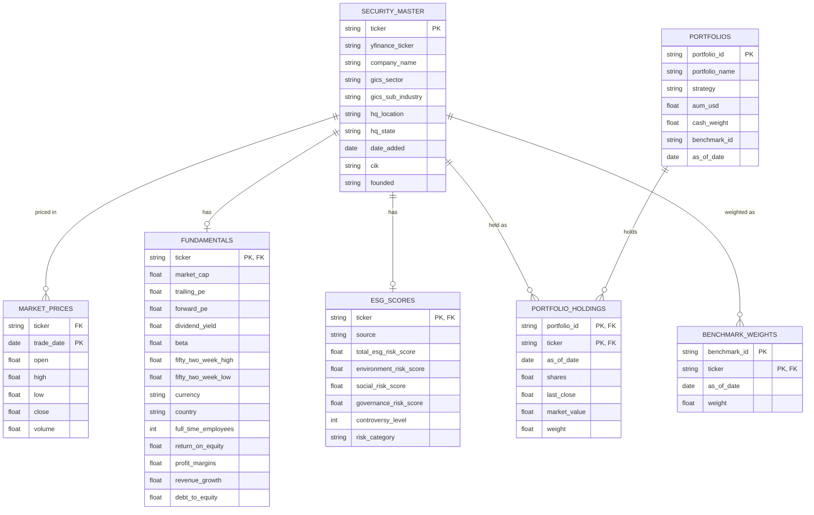

# Fin Analytics API — Data Model

This documents the shape of BigQuery dataset `fin_analytics` (7 tables,
populated by [`etl/run_pipeline.py`](../etl/run_pipeline.py) — see
[`../README.md`](../README.md) for how it's loaded) and why it's structured
this way. Scope note: this project is an API/GCP showcase, not a data-
engineering one (see `.claude/context.md`), so this is a lightweight
reference diagram, not a formal dimensional model (no fact/dim typing, no
SCD handling) — BigQuery also doesn't enforce any of the keys below; they're
join conventions followed by the ETL and the API's SQL, not constraints.

## Entity-relationship diagram

## Why this shape

`security_master` is the hub: every other table hangs off `ticker`.
`market_prices` / `fundamentals` / `esg_scores` are satellites around it —
one time series, one latest-snapshot row, and one latest-snapshot row per
ticker, respectively. That split (rather than one wide table) exists
because the three feeds have genuinely different grain and update
cadence — daily OHLCV bars vs. point-in-time company/ESG snapshots — which
mirrors how a real buy-side data org receives them as separate vendor
feeds (market data vendor, fundamentals vendor, ESG ratings provider).

`portfolios` / `portfolio_holdings` / `benchmark_weights` are the portfolio
side: `portfolio_holdings` is the bridge between `portfolios` and
`security_master` (portfolio_id + ticker → weight/shares/market_value),
and `benchmark_weights` is the same shape one level up (ticker → weight for
a given `benchmark_id`, independent of any single portfolio).

Two things worth calling out rather than glossing over:
- **No `benchmarks` dimension table.** `benchmark_id` is a plain string
  that `portfolios.benchmark_id` and `benchmark_weights.benchmark_id` both
  happen to use consistently (currently all 5 portfolios point at the same
  `BM_BROAD500`). A real model would likely promote this to its own table
  once more than one benchmark exists; skipped here since it would be a
  table with no columns beyond an ID.
- **Keys are convention, not enforcement.** BigQuery has no primary/foreign
  key constraints — joins correctness is maintained by the ETL (see
  `etl/generate_portfolios.py`'s merges) and by the API's SQL (see each
  router under `app/routers/`), not by the database.
